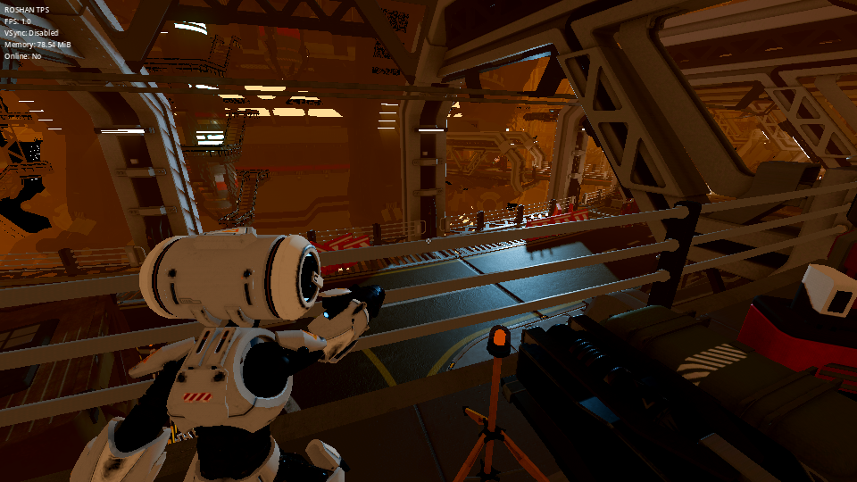

# ROSHAN TPS

A personal third-person shooter for me and my friends, running on
**Godot 4.7.2-stable**.

**Developer / modifier:** Roshan

> **This is a personal derivative of the official Godot Third-Person Shooter demo**
> (<https://github.com/godotengine/tps-demo>). The gameplay code, every 3D model,
> animation, texture, sound and music track were made by the upstream authors.
> See [Credits & licence](#credits--licence). My changes are a text-only
> rebrand, a settings bug fix, an automated test suite, CI and documentation.
> Full list: [`docs/CHANGES_FROM_UPSTREAM.md`](docs/CHANGES_FROM_UPSTREAM.md).



*Real screenshot from a validation run on a GPU-less cloud machine (OpenGL
Compatibility renderer, software rendering, 960×540). On a real GPU with the
default Forward+ renderer the game looks considerably better (volumetric fog,
GI, SSAO).*

## What's in the game (all inherited from upstream and verified)

* Third-person robot character: run, jump, mouse/gamepad camera with collision-aware spring arm.
* Aim mode (toggle or hold) with over-the-shoulder camera and crosshair; shooting with bullet impacts.
* Red-robot enemies that detect, approach, charge and fire lasers. They take damage, explode into parts and respawn after 15 s.
* Large industrial level with LightmapGI / VoxelGI / SDFGI options, reflection probes, volumetric fog.
* Main menu with animated 3D background, graphics settings (display mode, V-Sync, FPS cap,
  resolution scale & FSR, TAA/MSAA/FXAA/SMAA, shadows, GI type/quality, SSAO, SSIL,
  bloom, volumetric fog), saved to `user://settings.ini`.
* **Play Online**: host or connect to a LAN/IP game (ENet, upstream feature).
* F3 debug overlay (FPS, V-Sync, memory, online status).

What changed in ROSHAN TPS:

* Window title, loading screen text and F3 overlay say **ROSHAN TPS**.
* Fixed: *SSAO → Disabled* was ignored (SSAO stayed on).
* Headless automated test suite (`tests/`) and GitHub Actions CI.

## Branding note

The rebrand is **text-only by design**: no image assets were replaced. The main
menu still shows the original **"TPS Demo" title image**, the upstream window
icon and the Godot boot splash.

## Requirements

* **Godot 4.7.2-stable**, standard build (not .NET):
  <https://godotengine.org/download/archive/4.7.2-stable/>
* A GPU with Vulkan support is recommended (Forward+ renderer). The project is about 1.3 GB.
  The first import takes a while.

## Install & run

```bash
git clone https://github.com/Manash07Bhoi/roshan-tps-godot.git
cd roshan-tps-godot
# Open in the editor (first import may take a few minutes):
godot --editor --path .
# …or run the game directly:
godot --path .
```

The game starts in exclusive fullscreen by default. Use **F11** or **Alt+Enter**
to toggle, or change *Display Mode* in Settings.

If your machine has no Vulkan-capable GPU, you can try the OpenGL renderer:
`godot --path . --rendering-method gl_compatibility` (fewer effects).

## Controls

| Action | Keyboard / mouse | Gamepad |
|---|---|---|
| Move | W A S D / Arrow keys | Left stick / D-pad |
| Look | Mouse | Right stick |
| Jump | Space | A / Cross |
| Aim (tap = toggle, hold = hold) | Right mouse button | Left trigger (L2) |
| Shoot (while aiming) | Left mouse button | Right trigger (R2) |
| Back to menu | Escape | Start |
| Toggle fullscreen | F11 / Alt+Enter | — |
| Toggle debug overlay | F3 | — |

## Testing status (summary)

Full details, including what could **not** be tested: [`docs/TEST_REPORT.md`](docs/TEST_REPORT.md).

| Area | Status |
|---|---|
| Headless import (Godot 4.7.2) | PASS |
| Automated tests (25 checks: resources, input map, settings, gameplay smoke) | PASS (25/25) |
| Menu, settings, online panel, loading screen: graphical, Forward+ (software Vulkan) | PASS |
| Gameplay: graphical, Compatibility renderer (software OpenGL, ≈1 FPS) | PASS for movement, camera, aim, shoot, back to menu, quit |
| Gameplay: graphical, Forward+ on software Vulkan | BLOCKED: level load freezes at 38 % on this GPU-less test machine (engine/driver-level, also happens on unmodified upstream) |
| Online host/connect, gamepad, audio output, real GPU, Android | NOT TESTED (no second machine, controller, sound device or GPU available) |
| Clean clone of this repo → import → tests | PASS (see test report) |

Run the tests yourself:

```bash
godot --headless --import --path .
godot --headless --path . res://tests/test_runner.tscn   # exit code 0 = all passed
```

## Development story video

[`media/ROSHAN_TPS_Development_Story.mp4`](media/ROSHAN_TPS_Development_Story.mp4): 29 s,
vertical 1080×1920, cut **only from real recordings** made during this work (terminal
session, menu capture, gameplay capture, GitHub screenshots). Sped-up parts are
labelled on screen. Sources and editing steps: [`media/EDITING_NOTES.md`](media/EDITING_NOTES.md).

## Known limitations

* The original "TPS Demo" title image, icon and boot splash remain (text-only rebrand).
* SSAO *Medium* and *High* are internally swapped upstream; kept as-is to preserve default visuals.
* `physics/3d/physics_engine="Bullet"` is a Godot 3 leftover that Godot 4 ignores; the
  engine's default physics server is used. Left unchanged to avoid altering physics feel.
* Asset import warnings inherited from upstream: `door.dae` references a missing
  `doorsimple_d.png` (upstream issue #217) and a duplicate `Cannon_Charge` animation (#218).
* Settings saved by the original demo are not migrated, because the user-data folder name changed with the title.
* No pause menu, credits screen or Android/touch support. None of these exist upstream, and none were invented.

## Credits & licence

* **ROSHAN TPS rebrand, fixes, tests, docs:** Roshan
* **Original game code:** Juan Linietsky and the Godot Engine contributors (MIT)
* **3D assets & art:** Juan Linietsky, Fernando Miguel Calabró (CC BY 3.0); source materials from GameTextures.com
* **Music:** Christian Fernando Perucchi (CC BY 3.0)
* **Font:** PT Sans by ParaType Ltd. (SIL OFL 1.1)
* **Engine:** [Godot Engine](https://godotengine.org) (MIT)

See [`LICENSE.md`](LICENSE.md) (upstream, unchanged),
[`THIRD_PARTY_NOTICES.md`](THIRD_PARTY_NOTICES.md) and
[`docs/ATTRIBUTION.md`](docs/ATTRIBUTION.md).
Upstream repository: <https://github.com/godotengine/tps-demo>. The original
README is preserved at [`docs/UPSTREAM_README.md`](docs/UPSTREAM_README.md).

Not affiliated with or endorsed by the Godot Foundation or the original authors.
